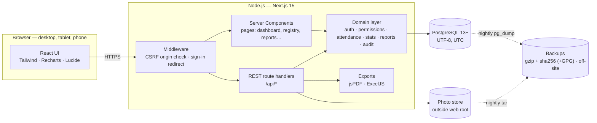
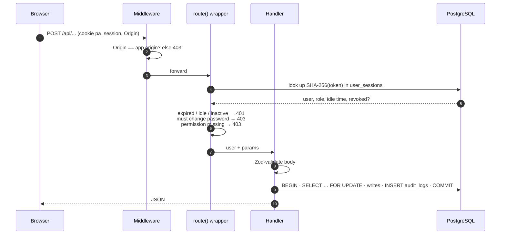
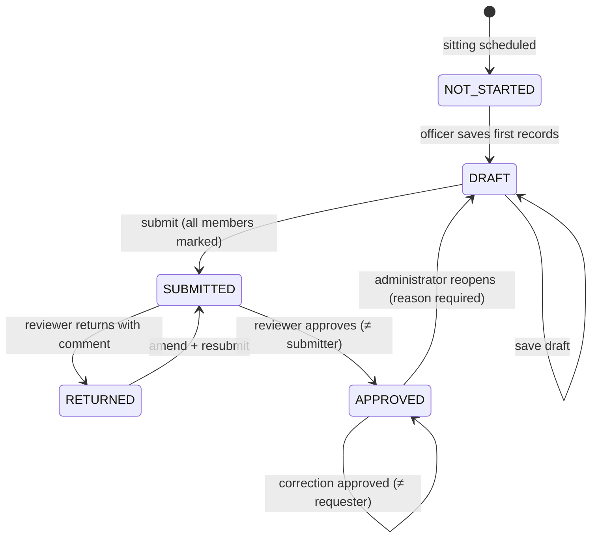
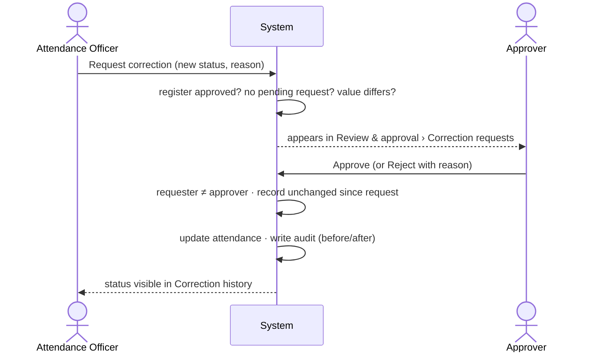
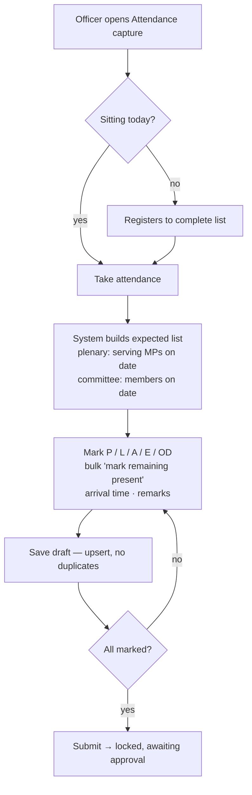

# 3. System architecture and workflows

## 3.1 Architecture overview

A single Next.js 15 (App Router) application serves both the user interface and a REST API,
backed by PostgreSQL. Pages are React Server Components that read the database directly through a
small data-access layer; interactive parts are client components that call the REST API and
then refresh the server-rendered view. There is one codebase, one deployable and one database.



### Layers

| Layer | Location | Responsibility |
|---|---|---|
| Pages | `src/app/(app)/*/page.tsx` | Server-rendered screens; call `requireUser(permission)` first |
| Client components | `*-form.tsx`, `*-manager.tsx`, `components/register` | Forms, dialogs, register grid, charts |
| REST API | `src/app/api/**/route.ts` | Every handler is wrapped by `route({ permission })` → auth, RBAC, Zod validation, uniform errors |
| Domain | `src/lib/*.ts` | `auth`, `permissions`, `attendance` (expected lists), `stats` (dashboard), `reports`, `export`, `audit`, `uploads` |
| Data | `src/lib/db.ts` | node-postgres (`pg`) pool; `?` placeholders translated to `$n` in `src/lib/sql.ts`; `rows / one / exec / transaction` helpers; parameterised SQL only |
| UI kit | `src/components/ui/*` | Buttons, form fields, dialogs, confirm, tables, badges, tabs (shadcn-style, no runtime dependency) |

## 3.2 Security architecture



- Session token: 256-bit random, sent as an `HttpOnly; SameSite=Strict; Secure` cookie; only its hash is stored.
- Passwords: bcrypt cost 12; constant-time behaviour for unknown usernames; per-account lockout plus per-IP rate limiting.
- Headers: CSP, HSTS, X-Frame-Options DENY, nosniff, Referrer-Policy, Permissions-Policy (`next.config.mjs`).
- Uploads: magic-byte type check, 2 MB limit, random file names outside `/public`, path-traversal guard, served via an authenticated route.
- Exports: formula-injection neutralised for CSV/Excel input; every export audited.

## 3.3 Register workflow



## 3.4 Correction workflow



## 3.5 Attendance capture flow



## 3.6 REST API

All endpoints return JSON (exports return files). Errors: `{ error, fields? }` with HTTP 400/401/403/404/409/413/415/423/429/500.

| Method & path | Permission | Purpose |
|---|---|---|
| `POST /api/auth/login` · `/logout` · `/password` | — / signed-in | Sign in, sign out, change password |
| `GET/POST /api/mps` | mps.view / mps.manage | List (filters, paging) / create |
| `GET/PATCH/DELETE /api/mps/:id` | mps.view / mps.manage | Read / update (incl. leaving office) / delete if no history |
| `POST /api/mps/:id/membership` | mps.manage | Record party or seat change |
| `GET/POST/DELETE /api/mps/:id/photo` | mps.view / mps.manage | Serve / upload / remove photograph |
| `POST /api/mps/import[?dryRun=1]` | mps.manage | CSV import with validation |
| `GET/POST /api/parties`, `PATCH/DELETE /api/parties/:id` | reference.manage | Parties |
| `GET/POST /api/regions`, `…/:id` · `GET/POST /api/constituencies`, `…/:id` | reference.manage | Regions, constituencies |
| `GET/POST /api/calendar/:kind`, `PATCH/DELETE /api/calendar/:kind/:id` | sittings.manage | Parliaments, sessions, meetings |
| `POST /api/committees`, `PATCH/DELETE /api/committees/:id`, `GET/PUT …/:id/members` | sittings.manage | Committees and membership |
| `GET/POST /api/sittings[?bulk=1]`, `GET/PATCH/DELETE /api/sittings/:id` | sittings.view / manage | Sittings |
| `GET/PUT /api/sittings/:id/register` | attendance.capture | Load / save register (upsert) |
| `POST /api/sittings/:id/register` `{action}` | capture / review / admin | submit · approve · return · reopen |
| `GET/POST /api/corrections`, `POST /api/corrections/:id` | corrections.* | List / request / approve or reject |
| `GET /api/reports?type=…&format=json\|pdf\|xlsx` | reports.view / export | All reports and exports |
| `GET/POST /api/users`, `PATCH/POST /api/users/:id` | users.manage | Users; POST on `:id` resets password |
| `GET /api/audit[?format=xlsx]` | audit.view | Audit search and export |
| `GET/PATCH /api/settings` | settings.manage | Settings |

## 3.7 Project structure

```
database/schema.sql          PostgreSQL schema, constraints, base roles and settings
scripts/                     migrate · seed (demo) · create-admin · backup.sh · restore.sh
src/middleware.ts            CSRF origin check, sign-in redirect
src/lib/                     domain + data layer (server-only unless noted)
src/components/ui/           design-system components
src/components/register/     attendance register grid (capture, review, corrections)
src/app/login, change-password
src/app/(app)/               dashboard · members · parties · constituencies · sittings
                             attendance · approvals · reports · users · audit · settings
src/app/api/                 REST route handlers
tests/                       unit tests (vitest)
docs/                        this documentation
```
